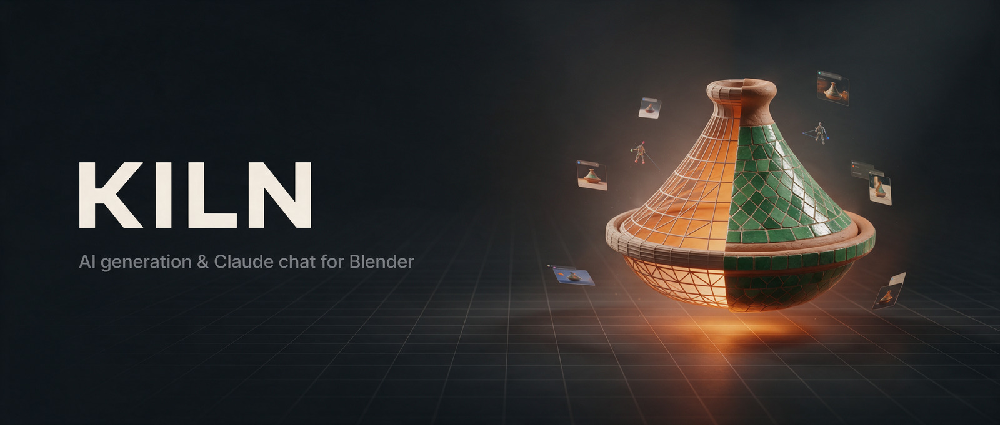
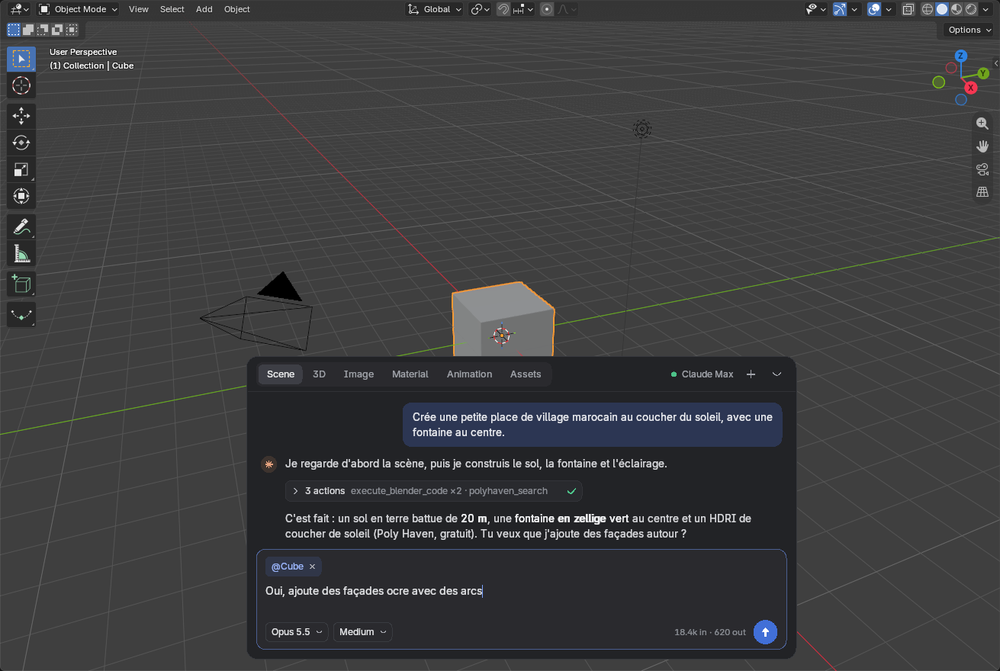
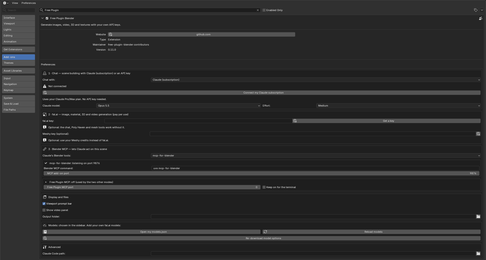
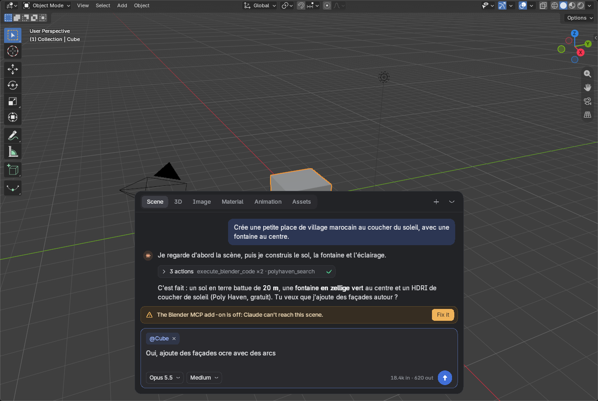
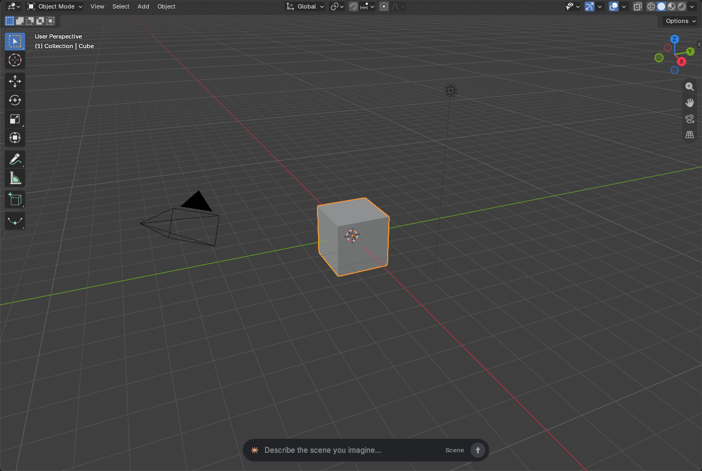
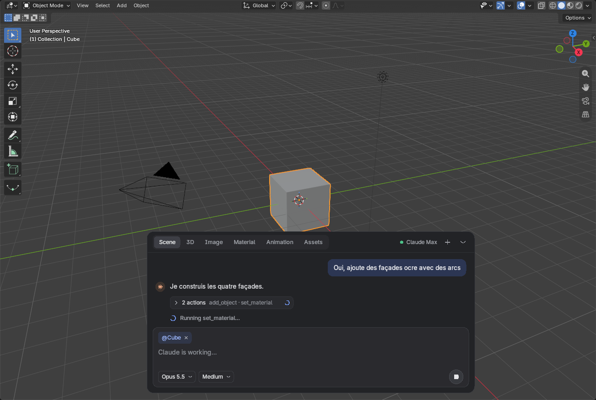
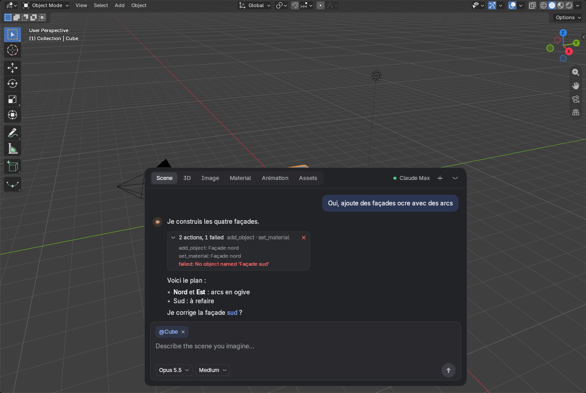
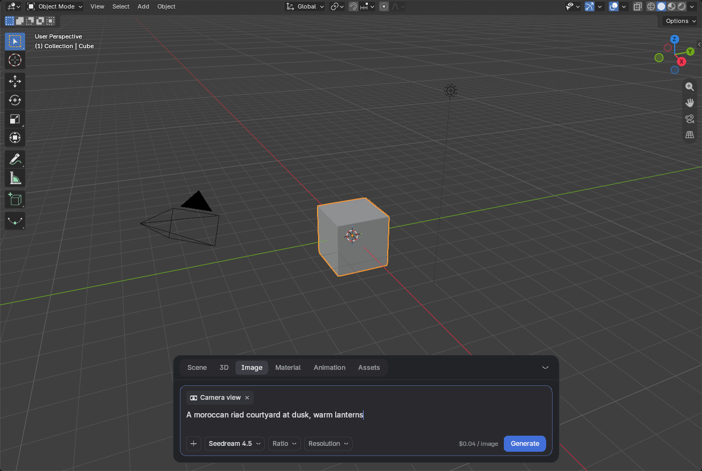
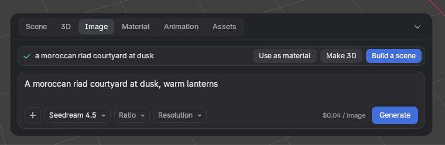
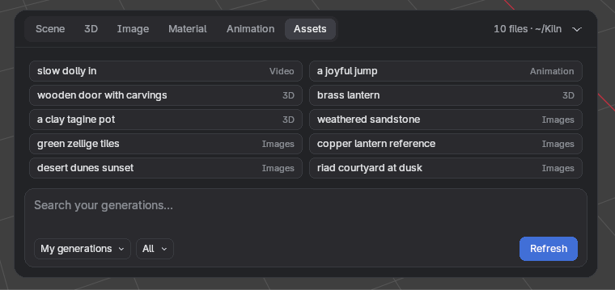

<p align="center">
  
</p>

<p align="center">
  <a href="https://github.com/RayaneChCh-dev/kiln-plugin-blender/releases/latest"></a>
  <a href="https://github.com/RayaneChCh-dev/kiln-plugin-blender/actions/workflows/ci.yml"></a>
  
  
  <a href="LICENSE"></a>
  <br>
  
  
  
</p>

<p align="center">
  <b>Describe a scene, and Claude builds it in Blender.</b><br>
  Generate images, materials, 3D models, animations and video with <b>your own</b> fal.ai key.<br>
  No middleman platform, no extra subscription, and no Python dependencies.
</p>

<p align="center">
  <a href="#-quick-start">Quick start</a> ·
  <a href="#-features">Features</a> ·
  <a href="#-step-by-step-setup">Setup</a> ·
  <a href="#-using-kiln">Usage</a> ·
  <a href="#-pricing">Pricing</a> ·
  <a href="#-faq--troubleshooting">FAQ</a> ·
  <a href="#-development">Development</a>
</p>

---

<p align="center">
  
</p>

> **Kiln** is the name of this project. The extension id (`free_plugin_blender`) and the sidebar
> tab (**Free Plugin**) keep their original names, so existing installs keep working.

## ✨ Features

| | What you get | Powered by | Cost |
|---|---|---|---|
| 💬 | **Chat with Claude in the viewport.** Claude models, lights and dresses your scene | Your **Claude Pro / Max** subscription (via Claude Code) | included in your plan |
| 💬 | Same chat with an API key instead | **OpenAI**, **Gemini** or **DeepSeek** | pay per use |
| 🖼️ | Text / image / camera view → **image** | fal.ai · Seedream 4.5, Nano Banana, FLUX.2… | ~$0.04 / image |
| 🧱 | **Tileable material** on the active object (with computed relief) | fal.ai · Seedream 4.5 | ~$0.04 |
| 🗿 | Text / image / camera view → **3D model** | fal.ai · TRELLIS, TRELLIS 2, Tripo, Hunyuan3D, Meshy 7 | $0.02 – $0.53 |
| 🦴 | **Auto-rig** + walk / run cycles | fal.ai · Meshy rigging | ~$0.20 |
| 🕺 | **678 animation presets**, or a motion described in text | fal.ai · Meshy, Hunyuan Motion | $0.08 – $0.32 |
| 🎨 | **Retexture** a model | fal.ai · Meshy retexture | see fal.ai |
| 🎬 | Text / camera view → **video** (hidden by default) | fal.ai · Kling 3.0, Veo 3.1, Seedance… | ~$0.14 / s |
| 🌄 | HDRIs, PBR textures, 3D models | **Poly Haven** (CC0) | **free** |
| 🗂️ | **My generations**: everything you generated, filtered and one click away | your `~/Kiln` folder | **free** |
| 🔁 | Copy a motion between rigs, voxel remesh, LOD | Blender | **free** |

Any other fal.ai model can be added from its id, and its options appear automatically.

## 🚀 Quick start

1. **Download** `free_plugin_blender-X.Y.Z.zip` from the
   [**latest release**](https://github.com/RayaneChCh-dev/kiln-plugin-blender/releases/latest).
2. In Blender: **Edit → Preferences → Get Extensions → ⌄ → Install from Disk…** and pick the zip.
3. **Edit → Preferences → Add-ons → Free Plugin Blender**:
   - click **Connect my Claude subscription** to chat with Claude;
   - paste your **fal.ai key** to generate images, materials, 3D and video.
4. Click the **"Describe the scene you imagine…"** bar at the bottom of the 3D viewport.

Each step is explained in detail below.

---

## 📦 Step-by-step setup

### What you need

| Requirement | Needed for | Required? |
|---|---|---|
| [Blender](https://www.blender.org/download/) **4.2 or newer** (tested on 5.2) | everything | ✅ yes |
| A **Claude Pro or Max** subscription + [Claude Code](https://claude.com/claude-code) | chatting with Claude | for the Claude chat |
| A **fal.ai** account **with credits** + an API key | images, materials, 3D, rigging, animation, video | for generation |
| The [`mcp-for-blender`](https://pypi.org/project/mcp-for-blender/) add-on + [`uv`](https://docs.astral.sh/uv/) | the *mcp-for-blender* tool mode (the default mode needs nothing) | optional, see [step 5](#step-5-let-claude-act-on-the-scene-blender-mcp) |
| An OpenAI, Gemini or DeepSeek API key | chatting with another model instead of Claude | optional |

Poly Haven assets and the local mesh tools work with **no account at all**.

### Step 1: Install the latest release

> [!IMPORTANT]
> Always install the **latest release** to get the newest features and fixes. The zip
> attached to each release is built and tested by CI. You don't need to build anything.

1. Open the [**Releases page**](https://github.com/RayaneChCh-dev/kiln-plugin-blender/releases/latest).
2. Under **Assets**, download **`free_plugin_blender-X.Y.Z.zip`**. Do **not** unzip it.
   (Ignore *Source code (zip)*: that is the raw repository, not the extension.)
3. Open Blender and go to **Edit → Preferences…**.
4. In the left column, click **Get Extensions**.
5. Click the **⌄** menu in the top-right corner of the window and choose **Install from Disk…**.
6. Select the downloaded zip and click **Install from Disk**.
   *Shortcut: you can also drag the zip from your file manager and drop it onto the Blender window.*
7. The extension is now listed and enabled under **Add-ons** as **Free Plugin Blender**.

**Updating:** download the new zip and repeat steps 3 to 6. Blender replaces the old
version. Your keys and settings are kept.

### Step 2: Open the add-on preferences

**Edit → Preferences → Add-ons**, type `Free Plugin` in the search field, then click the
**▸** arrow next to **Free Plugin Blender** to unfold it. The preferences are grouped in
numbered sections:

<p align="center">
  
</p>

| Section | What it's for |
|---|---|
| **1 · Chat** | Who you chat with: your Claude subscription (default) or an API key |
| **2 · fal.ai** | Your fal.ai key for every generation, and an optional Meshy key |
| **3 · Blender MCP** | How Claude reaches the scene (its tools) |
| **Display and files** | The viewport prompt bar, the video panel, where outputs are saved |
| **Models** | Add your own fal.ai models (`models.json`) |
| **Advanced** | A custom path to the `claude` executable |

Blender saves preferences automatically by default. If you turned that off, click
**☰ (bottom-left) → Save Preferences** after changing anything.

### Step 3: Connect your Claude subscription

The chat runs on **your own Claude Pro / Max plan** through Claude Code. You don't need an
Anthropic API key and you don't pay per token.

1. **Install Claude Code** if you don't have it. If it is missing, section **1 · Chat**
   shows *"Claude Code is not installed"* and a **How to install Claude Code** button. That
   button copies the install command to your clipboard and opens the Claude Code page.
   Paste the command in a terminal:

   ```bash
   curl -fsSL https://claude.ai/install.sh | bash
   ```

   (Windows and other install methods: see <https://claude.com/claude-code>.)
   Then click **⟳** (*Check again*) in the preferences.
2. Make sure **Chat with** is set to **Claude (subscription)**.
3. Click **Connect my Claude subscription**. Your browser opens the Claude sign-in page.
   Sign in with the account that has your Pro / Max plan and approve.
   - The preferences show *"Finish signing in in your browser…"* in the meantime.
   - If the page shows you a **code**, paste it into the **Code** field and click ✓.
     If it doesn't show one, there's nothing to paste.
4. Once connected, the section shows your plan (for example *"Claude Max · you@example.com"*),
   and the viewport bar shows **● Claude Max**. **Disconnect** signs you out.
5. Optionally, choose the **Claude model** (Opus 5.5 by default) and the **Effort**
   (Medium by default). Higher effort gives better results on hard scenes, but answers are
   slower and use more of your plan. You can also change both from the viewport bar.

> [!NOTE]
> If Claude Code is installed somewhere unusual, set its location in
> **Advanced → Claude Code path**.

### Step 4: Create a fal.ai account, add credits, paste your key

fal.ai hosts every generation model the extension uses (Seedream, Kling, TRELLIS, Tripo,
Hunyuan, Meshy…). You pay fal.ai directly, per generation, and there's no subscription.

**4a. Create an account**

1. Go to <https://fal.ai> and click **Sign up** (GitHub, Google or e-mail).

**4b. Add credits** (generations fail without them)

1. Open your dashboard's **Billing** page: <https://fal.ai/dashboard/billing>.
2. Add a payment method and **top up some credits**. A few dollars is enough to start:
   an image costs about $0.04 and a TRELLIS 3D model about $0.02.
3. Optional: enable auto top-up or set a spending limit there if you want to control costs.

**4c. Create an API key**

1. Open **API Keys**: <https://fal.ai/dashboard/keys>. In Blender, the **Get a key**
   button next to the *fal.ai key* field opens the same page.
2. Click **Add key** / **Create key**, give it a name (e.g. `blender`) and keep the
   default **API** scope.
3. **Copy the key right away.** fal.ai shows the full key only once. It looks like
   `xxxxxxxx-xxxx-xxxx-xxxx-xxxxxxxxxxxx:xxxxxxxxxxxxxxxxxxxxxxxx` (id + `:` + secret).
   Copy the **whole** string, including the part after the colon.

**4d. Paste it in Blender**

1. **Edit → Preferences → Add-ons → Free Plugin Blender → 2 · fal.ai**.
2. Click the **fal.ai key** field, paste (**Ctrl+V**), press **Enter**. The field is a
   password field, so it shows dots.
3. That's it: the sidebar status and the viewport bar stop asking for a key, and every
   **Generate** button is ready.

> [!TIP]
> **Prefer environment variables?** Leave the field empty and set `FAL_KEY` before
> starting Blender (`export FAL_KEY=...`). The preference wins when both are set.
>
> **Meshy key (optional):** only if you already have Meshy credits and want to spend them
> instead of fal.ai for 3D, rigging and retexture. Get it at
> <https://www.meshy.ai/settings/api> (or set `MESHY_API_KEY`).

> [!WARNING]
> Your key is stored in Blender's user preferences on your machine and is only sent to
> fal.ai. Never share it or commit it. If it leaks, delete it on the fal.ai **API Keys**
> page and create a new one.

### Step 5: Let Claude act on the scene (Blender MCP)

Claude edits your scene through an MCP server. In **3 · Blender MCP**, choose
**Claude's Blender tools**:

| Mode | Claude gets | Extra install | Best for |
|---|---|---|---|
| **Free Plugin tools only (lighter)** (default) | only the built-in tools | **none** | the simplest setup and the fewest tokens |
| **mcp-for-blender** | the full `mcp-for-blender` toolset | `uv` + the `mcp-for-blender` add-on | the most complete toolset |
| **mcp-for-blender + Free Plugin tools** | both, and it uses ours first | same | nothing missing, but the heaviest context |

**Default mode (Free Plugin tools only):** nothing to install. The built-in server runs inside
Blender on `127.0.0.1` with a secret token. For tasks with many steps Claude writes one script
(`run_script`) that calls the tools itself, so only its result comes back. In our measurements
it sends 1.7× to 3.7× fewer tokens than mcp-for-blender ([docs/BENCHMARK.md](docs/BENCHMARK.md)).

**mcp-for-blender mode:**
1. Install [`uv`](https://docs.astral.sh/uv/getting-started/installation/)
   (`curl -LsSf https://astral.sh/uv/install.sh | sh`).
2. Install and enable the Blender add-on of
   [`mcp-for-blender`](https://pypi.org/project/mcp-for-blender/) (**Get the mcp-for-blender add-on**
   button). It listens on port **9876**.
3. The box should show **✓ mcp-for-blender: listening on port 9876**. If it shows
   *"Nothing listens on port 9876"*, the add-on is off.

If something is missing, the viewport bar shows a banner explaining it in one sentence, with a
**Fix it** button:

<p align="center">
  
</p>

### Optional: chat with OpenAI, Gemini or DeepSeek

In **1 · Chat**, set **Chat with** to **OpenAI**, **Gemini** or **DeepSeek (API key)**, then
paste the key (**Get a key** opens the right page):

| Provider | Get a key | Environment variable |
|---|---|---|
| OpenAI | <https://platform.openai.com/api-keys> | `OPENAI_API_KEY` |
| Gemini | <https://aistudio.google.com/apikey> (free tier with limited quota) | `GEMINI_API_KEY` or `GOOGLE_API_KEY` |
| DeepSeek | <https://platform.deepseek.com/api_keys> | `DEEPSEEK_API_KEY` |

The model list is read live from the provider (the newest model is selected by default). The agent
loop runs inside the extension with the built-in tools, so Claude Code and `mcp-for-blender`
aren't needed. Requests are billed to your account with that provider.

> **Coming later:** signing in with a **ChatGPT** or **Gemini subscription** (like the Claude
> one, no API key), plus OpenRouter and local models (Ollama).
> See the [roadmap](docs/ROADMAP.md).

---

## 🎛️ Using Kiln

### The viewport prompt bar

At the bottom of every 3D view there is a pill: **"Describe the scene you imagine…"**.

<p align="center">
  
</p>

Click it to open the card:

- **Mode tabs** at the top: *Scene* (chat with Claude), *3D*, *Image*, *Material*,
  *Video* (if enabled), *Animation*, *Assets* (Poly Haven). On the right: the account status
  (**● Claude Max**), **+** (new conversation) and **⌄** (collapse).
- **Selected objects** appear as **@mentions** (× to remove one). Claude gets the selection along with your message.
- At the bottom: **+** (attach the camera view, a render of the scene or an image; in *Scene* mode, show Claude
  a viewport capture, the camera view, a render or an image file), the **model menu**, quick settings as chips,
  and in *Scene* mode the Claude model, the effort, the tokens of the last answer and the round **send** button.

**Enter** sends, **Shift+Enter** adds a new line, **Esc** closes. While you type, Blender
shortcuts are paused. Click anywhere else to give them back.

### Building a scene with Claude

Ask in plain language, in any language. Claude looks at the scene, then builds it.

<table>
  <tr>
    <td width="50%"></td>
    <td width="50%"></td>
  </tr>
  <tr>
    <td align="center"><sub>While Claude works, the current step is shown live. <b>■</b> stops it.</sub></td>
    <td align="center"><sub>Tool calls are folded into one line. Click to expand. A red ✕ marks a failure.</sub></td>
  </tr>
</table>

Claude can model with Python, inspect the scene, take screenshots, and call every Kiln operator
(Poly Haven, image, material and 3D generation…). Generations it starts are billed to
your fal.ai account like the ones you start yourself.

### Generating images, materials, 3D and video

Switch to the **Image**, **Material**, **3D**, **Video** or **Animation** tab, type a prompt, pick a model, and
check the **price shown next to the Generate button** before you click.

<p align="center">
  
</p>

Attach the **camera view** with **+** to generate from what the camera sees (image → image,
image → 3D, image → video). **Render scene** does a full render with the scene's engine first (like F12:
seconds with EEVEE, longer with Cycles) and starts from that.

### After an image: use it

When an image is done, the **Image** tab shows it with three actions:

<p align="center">
  
</p>

| Action | What happens | Cost |
|---|---|---|
| **Use as material** | the image becomes the base colour of the selected mesh (with relief from the colour) | free |
| **Make 3D** | the **3D** tab opens with the image attached: pick a model, check the price, then *Generate* | the 3D model's price |
| **Build a scene** | the image is sent to Claude, who builds a scene like it (layout, objects, light, mood) with simple shapes and free Poly Haven assets, then asks whether you want textures and materials | your Claude plan |

The same actions are on every image in **Assets → My generations** (click the image, the row appears under
the list) and in the sidebar's **Generations** history. Claude sees the image itself: it's sent with the
message (resized to 1568 px). With an API key, OpenAI and Gemini see it too; DeepSeek can't read images,
so it's told to ask you to describe it.

### My generations

Everything you generate is saved in **`~/Kiln`** (change it in *Preferences → Display and files →
Output folder*), sorted into `images/`, `textures/`, `models/`, `rigs/`, `animations/` and `videos/`.
In the **Assets** tab, switch the source chip from *Poly Haven* to **My generations**:

<p align="center">
  
</p>

- the filter chip shows **All · 3D · Animation · Images · Video**;
- type in the field to filter by name, as you type; **Refresh** re-reads the folder;
- **click an item** to put it back in the scene: a 3D model or animation is imported at the 3D cursor,
  a material image goes on the active mesh, an image follows *Image → Put result* (plane, camera
  background or image only), and a video goes into the Video Sequencer.

The sidebar's **Assets** tab has the same list. Files saved by versions before 0.12 (in the
extension's own folder) are listed too.

### The sidebar

Press **N** in the 3D view and open the **Free Plugin** tab: a status header (fal.ai, Claude Code,
MCP, Meshy), tabs **Scene · 3D · Image · Video · Animation · Assets**, every model option, and the
**Generations** history.

<details>
<summary><b>Animation in detail</b></summary>

The character is the **active object** (its mesh or its armature) and must face **-Y** (a Meshy
requirement).

- **Presets** (~$0.32): 678 Meshy animations (walk, run, dance, combat, everyday gestures…)
  with search, category and an *In place* filter.
  - **Unrigged** character: Meshy rigs and animates it. The rigged copy replaces the original,
    which is hidden, not deleted.
  - **Rigged** character: the motion is copied onto your rig as a new *action*.
- **Free motion** (~$0.08): describe a motion ("a joyful jump"), 0.5 to 12 s. Hunyuan Motion
  generates it, then it is retargeted onto your rig.
- **Copy a motion** (free): select the animated armature, Ctrl+click the target, *Copy motion*.
  It recognises SMPL, Meshy, Mixamo, Rigify and Unreal bone names (at least 8 shared joints).

Every motion is an action kept in the .blend (*fake user*).
</details>

<details>
<summary><b>Choosing and adding models</b></summary>

| Panel | Built-in models |
|---|---|
| Image | Seedream 4.5, Nano Banana, Nano Banana Pro, FLUX.2, Qwen Image, FLUX.1 schnell |
| Video | Kling 3.0 Pro / Standard, Kling 2.5 Turbo, Veo 3.1 / Fast, Seedance 1 Pro, Hailuo 02, Wan 2.2 |
| 3D | TRELLIS, TRELLIS 2, Tripo H3.1, Hunyuan3D 3.1 Pro, Meshy 7 (fal.ai), Meshy (your key) |

**Quick settings** work the same for every model and are translated to each model's own fields:

| Mode | Settings |
|---|---|
| Image | Ratio, Resolution (1K/2K/4K), Quality, Format (PNG/JPEG/WebP) |
| 3D | Mode (Preview / Full), Type (Standard / Low-poly / Smart topology), Topology, Detail, PBR, Texture |
| Video | Duration, Resolution, Ratio, Audio |

**Any other fal.ai model:** choose *Other fal.ai model…*, paste its id (e.g. `fal-ai/flux/dev`)
and click ⟳. Its options appear automatically.

**Add it to the menu for good:** *Preferences → Open my models.json*, then *Reload models*:

```json
{
  "image": [
    {"key": "flux_dev", "label": "FLUX.1 dev", "cost": "$0.025 / MP",
     "text": "fal-ai/flux/dev"}
  ],
  "video": [],
  "mesh": []
}
```

`text` is the endpoint used with a prompt only, `image` the one used with an input image, and
`defaults` presets options (e.g. `{"generate_audio": false}`). An entry reusing a built-in `key`
replaces it.
</details>

<details>
<summary><b>Driving Blender from Claude Code in a terminal</b></summary>

The built-in MCP server also works from a terminal: in the preferences, pick a fixed
**Free Plugin MCP port**, tick **Keep on for the terminal**, then **Copy the terminal command**
copies the `claude mcp add --transport http …` command with its token.

Claude Code stops waiting for a tool after 60 s by default, while a generation keeps running
in Blender. Start it with a longer limit so `generate` and `run_script` can wait for the result:
`MCP_TOOL_TIMEOUT=960000 claude`. The chat inside Blender already does this.

With `mcp-for-blender`, Claude can call the operators directly:

```python
bpy.ops.freeplugin.generate_image(prompt="a moroccan riad courtyard at dusk")
bpy.ops.freeplugin.generate_texture(prompt="green zellige tiles")
bpy.ops.freeplugin.generate_3d(prompt="a clay tagine pot", model="trellis")
bpy.ops.freeplugin.generate_video(prompt="slow dolly in", model="kling25_turbo",
                                  options='{"duration": "10"}')
bpy.ops.freeplugin.animate_preset(preset_id=106)   # id from data/animations.json
bpy.ops.freeplugin.generate_motion(prompt="a joyful jump", duration=3)
```

These operators return immediately. Read the results with
`json.loads(bpy.context.window_manager.get("free_plugin_tasks", "[]"))`.
</details>

---

## 💰 Pricing

Kiln is free and open source. You only pay the providers you choose, at their own prices:

| Model (3D) | Input | fal.ai cost | Notes |
|---|---|---|---|
| **TRELLIS** | image | ~$0.02 | Cheapest, great for iterating |
| **TRELLIS 2** | image | ~$0.30 | Finer, clean UVs and remesh |
| **Tripo H3.1** | text or image | ~$0.30 | Good topology, PBR |
| **Hunyuan3D 3.1 Pro** | text or image | ~$0.38 (+$0.15 PBR) | Best textures |

TRELLIS only takes an image: with a text prompt, Kiln first draws a reference image with Seedream
(+$0.04), so a text → 3D model with TRELLIS costs about **$0.06**.

Prices were checked in October 2026 and may change. See [fal.ai/pricing](https://fal.ai/pricing) and
[meshy.ai/pricing](https://www.meshy.ai/pricing). The **video panel is hidden by default**
because it is the most expensive feature. Tick *Show video panel* in the preferences to show it.

## ❓ FAQ & troubleshooting

<details>
<summary><b>Generation fails with an authentication or "insufficient balance" error</b></summary>

Check that you pasted the **whole** fal.ai key (id **and** secret, around the `:`), and that your
fal.ai account has **credits** on <https://fal.ai/dashboard/billing>.
</details>

<details>
<summary><b>"Claude Code is not installed" even though I installed it</b></summary>

Restart Blender so it picks up your new `PATH`, or set **Advanced → Claude Code path** to the
`claude` executable (`which claude` in a terminal shows it).
</details>

<details>
<summary><b>Claude answers but nothing changes in the scene</b></summary>

Claude can't reach Blender. In the default mode, check that **3 · Blender MCP** shows
**Free Plugin MCP: on**. With an mcp-for-blender mode, enable the `mcp-for-blender` add-on (port 9876), or switch
**3 · Blender MCP** back to **Free Plugin tools only**. The bar's banner and its **Fix it** button tell
you which.
</details>

<details>
<summary><b>I have several Blender windows open</b></summary>

The MCP server talks to the Blender that holds the port. Each Blender has an id that Claude checks
before editing anything. To drive several, give each its own port.
</details>

<details>
<summary><b>Is it safe?</b></summary>

The chat runs `claude -p` with every built-in Claude Code tool disabled, and only the Blender MCP
server loaded and allowed. That server can run Python inside Blender (this is how Claude builds
scenes), and that Python has the same rights as Blender on your machine. Your keys never leave your
computer except to go to the provider they belong to.
</details>

---

## 🛠️ Development

```bash
uvx ruff@0.14.0 check .
python3 -m pytest -q                                           # no Blender
python3 scripts/run_blender_tests.py --blender /path/to/blender # headless Blender
python3 scripts/run_gui_tests.py --blender /path/to/blender     # real clicks, opens a window
python3 scripts/build.py                                       # builds dist/free_plugin_blender-X.Y.Z.zip
```

- Every change goes through a pull request to the protected `main` branch
  ([`feature-pr`](.claude/skills/feature-pr/SKILL.md) workflow). CI runs `lint`, `unit-tests`
  and `blender-tests`.
- **Release:** bump `version` in `free_plugin_blender/blender_manifest.toml`, merge, then push the
  tag `vX.Y.Z`. The *Release* workflow tests, builds and publishes the zip.
- After editing `free_plugin_blender/data/models.json`, run `python3 scripts/refresh_schemas.py`.
- Roadmap: [docs/ROADMAP.md](docs/ROADMAP.md).

<details>
<summary><b>Project structure</b></summary>

```
free_plugin_blender/
  __init__.py         registration
  prefs.py            keys, output folder, catalog access
  account.py          Claude subscription sign-in (claude auth)
  chat.py             chat: claude -p + MCP servers per mode, or the API-key agent
  agent.py            agent loop (model → tools → model), no bpy
  api_models.py       live model lists of API-key providers, cached
  mcpserver/          built-in MCP server: protocol.py, httpserver.py (no bpy), tools.py
  overlay/            viewport prompt bar (gpu/blf, text field, modal)
  catalog.py          model catalog (data/models.json + your models.json)
  params.py           model menus and options generated from schemas
  controls.py         quick settings → each model's fields (no bpy)
  ui_controls.py      those settings in the sidebar and the bar
  data/               models.json, animations.json and embedded fal.ai schemas
  props.py            panel settings (scene.free_plugin)
  operators.py        one operator per button (bpy.ops.freeplugin.*)
  animation.py        presets, free motion, motion copy
  presets.py          Meshy animation library and search (no bpy)
  rigmap.py           humanoid joints from bone names (no bpy)
  retarget.py         motion copy from one armature to another
  panels.py           N sidebar
  tasks.py            network on a worker thread, scene on the main thread
  scene.py            GLB import, materials, HDRI, image plane, video strip
  net.py              stdlib HTTP, downloads, data URIs
  providers/          fal.py, fal_schema.py, meshy.py, polyhaven.py, openai_compat.py (no bpy)
```
</details>

## 📄 License

[GPL-3.0-or-later](LICENSE). Poly Haven assets are CC0. Generated content is subject to each
provider's terms.

<p align="center"><sub>Banner generated with Seedream 5.0 Pro on Higgsfield AI.</sub></p>
